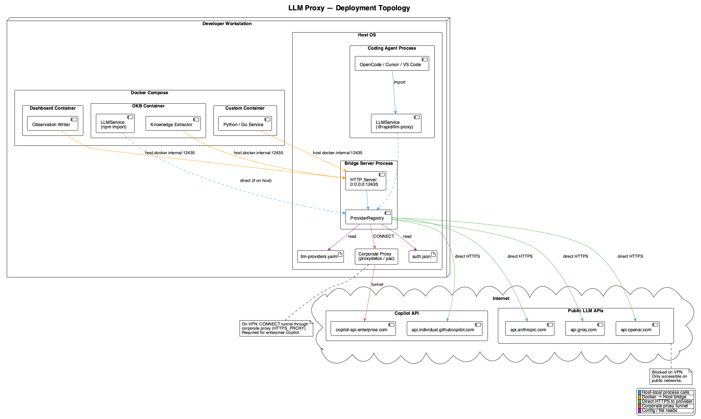
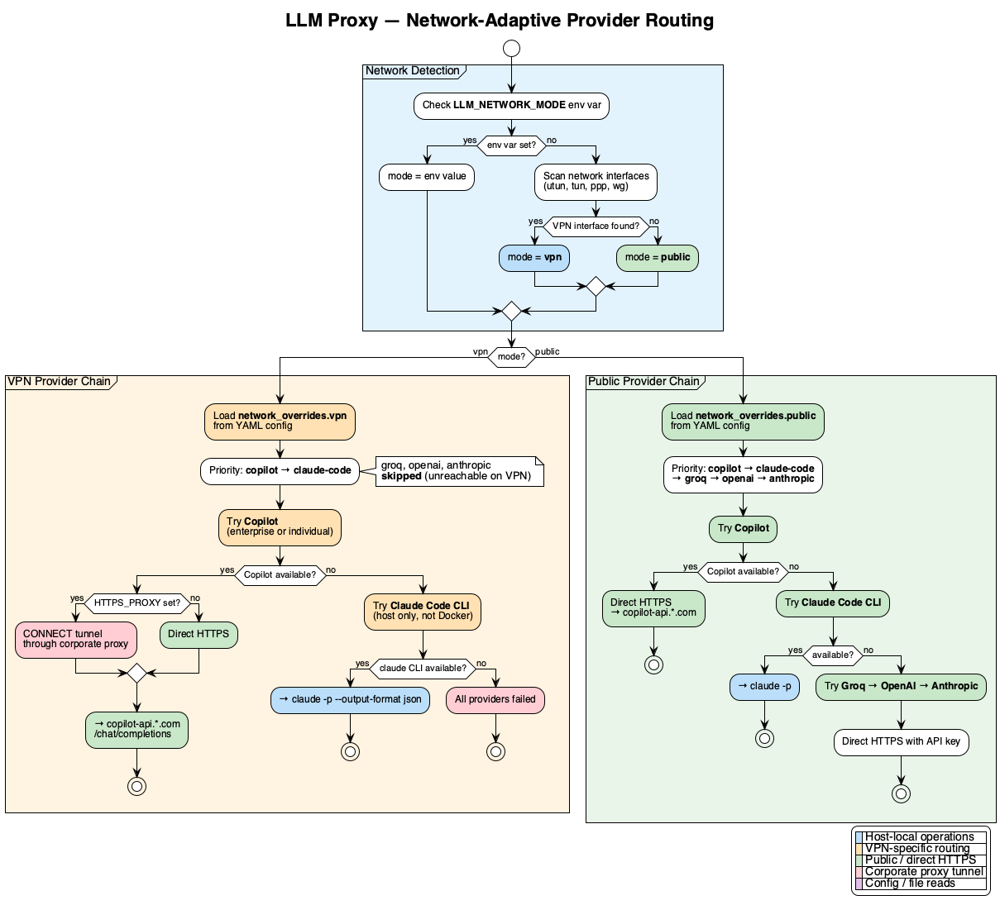

# rapid-llm-proxy

Unified LLM abstraction layer for AI-powered applications. Routes inference requests to one of five providers — GitHub Copilot, Claude Code CLI, Groq, OpenAI, or Anthropic — based on network context and per-consumer configuration. Detects VPN/corporate vs public networks, adapts routing automatically, logs every call to a local SQLite database, and exposes per-consumer usage data over HTTP for dashboards.

**Current version:** `@rapid/llm-proxy@2.0.0`

## What's new in 2.x

- **Persistent Claude CLI worker pool.** The `claude-code` dispatch is now two-tier: a warm pool of persistent `claude -p` stream-JSON workers (Tier 1, ~2–3 s, keyed by model + system prompt) serves most requests, with a cold `execFile` one-shot path (Tier 2, ~10–14 s) as overflow when every warm worker for a key is busy. Workers spawn lazily, evict when idle, and route around crash storms. `copilot` stays direct HTTP (not pooled). Disable with `LLM_PROXY_DISABLE_WORKER_POOL=1`.

## What's new in 2.0

- **Per-consumer token-usage logging.** Every completion is written to a local SQLite DB (`token_usage` table) with provider, model, process name, tokens, latency, and prompt preview. Read back via `GET /api/token-usage/{summary,recent}`.
- **Git-trackable JSON export.** The DB stays authoritative locally; a debounced JSON snapshot (default `.data/llm-proxy-export/token-usage.json`) is what teammates commit. Safety merge preserves rows missing from a freshly-reset local DB. Mirrors the LevelDB/JSON export pattern used elsewhere in the consumer project.
- **Per-process provider pin.** `GET/PUT /api/llm/settings` lets a dashboard force a service (e.g. `observation-writer`) to a specific provider+model. Pins win over `body.provider` in the auto-route, with automatic fall-through if the pinned provider becomes unreachable.
- **Client-disconnect reaping.** When the HTTP client disconnects (browser tab close, `obs-api` SIGTERM, etc.), the proxy aborts in-flight work — including killing any spawned `claude` CLI subprocess — instead of orphaning long-running child processes.
- **Corporate-vs-public launchd wrapper.** `bin/start-llm-proxy.sh` probes the health coordinator (then PAC host) to decide whether to inject `HTTPS_PROXY` / `HTTP_PROXY` before exec'ing the bridge. Lets the same launchd plist work on VPN and at home without manual env changes.
- **Five-provider stack.** `copilot`, `claude-code`, `openai`, `groq`, `anthropic` — all five reachable through `POST /api/complete`. API providers (`openai`, `groq`, `anthropic`) are skipped on VPN where the corporate firewall blocks them.

## Architecture


Two integration modes:

- **npm package** — `import { LLMService } from '@rapid/llm-proxy'` for Node.js apps that share the host's keychain
- **HTTP bridge** — `POST /api/complete` (default port `8089`, conventional launchd port `12435`) for Docker containers, Python, Shell, or any language



## Provider chain

Requests are auto-routed through the provider chain based on network mode, per-process pins, and availability:

```
Public network:    claude-code → copilot → groq → openai → anthropic
Corporate/VPN:     claude-code → copilot                  (API providers excluded)
Per-process pin:   <pinned provider>, fall through to auto-route on failure
```



## Quick start

```bash
npm install @rapid/llm-proxy            # from registry (once published)
npm install ./rapid-llm-proxy-2.0.0.tgz # from local tarball
```

### npm package (Node.js)

```javascript
import { LLMService } from '@rapid/llm-proxy';

const llm = new LLMService();
await llm.initialize();

const { text, provider } = await llm.complete({
  messages: [{ role: 'user', content: 'Summarize this document' }]
});

console.log(`${provider}: ${text}`);
```

### HTTP bridge (Docker / any language)

Start on the host:

```bash
LLM_PROXY_PORT=12435 node node_modules/@rapid/llm-proxy/proxy-bridge/server.mjs

# Or run via the launchd wrapper (auto-injects corporate proxy when on VPN):
./bin/start-llm-proxy.sh
```

Call from a Docker container:

```bash
curl -s http://host.docker.internal:12435/api/complete \
  -H "Content-Type: application/json" \
  -d '{"messages":[{"role":"user","content":"Hello"}], "process":"my-service"}' \
  | jq .content
```

The optional `"process"` field tags the row in `token_usage` so a dashboard can break usage down by consumer.

Docker Compose:

```yaml
services:
  my-app:
    environment:
      LLM_PROXY_URL: http://host.docker.internal:12435
    extra_hosts:
      - "host.docker.internal:host-gateway"
```

### Health check

```bash
curl -s http://localhost:12435/health | jq
# → {"status":"ok","mode":"direct-http+cli","networkMode":"corporate",
#    "providers":{"copilot":{"available":true,"method":"http"}, ...}}
```

## HTTP API

| Method | Path | Purpose |
|--------|------|---------|
| `POST` | `/api/complete` | Chat completion (auto-route or explicit provider) |
| `GET` | `/health` | Provider availability + detected network mode |
| `GET` | `/api/token-usage/summary?hours=24&bucketMinutes=2` | Per-provider/per-process totals + zero-filled timeline |
| `GET` | `/api/token-usage/recent?limit=50` | Latest N call rows with prompt preview |
| `GET` | `/api/llm/settings` | Current per-process pins, available providers, distinct processes seen |
| `PUT` | `/api/llm/settings` | Replace per-process pin map atomically |

The `token-usage` endpoints power the **Token Usage** page in the consumer project's health dashboard; the `llm/settings` endpoints back its **Settings** dialog.

## Configuration

Place `config/llm-providers.yaml` in your project root:

```yaml
providers:
  copilot:
    type: copilot
    auth_file: ~/.local/share/opencode/auth.json
  claude-code:
    type: claude-code
  groq:
    type: groq
    env_key: GROQ_API_KEY
  openai:
    type: openai
    env_key: OPENAI_API_KEY
  anthropic:
    type: anthropic
    env_key: ANTHROPIC_API_KEY

provider_priority: [claude-code, copilot, groq, openai, anthropic]

network_overrides:
  corporate:
    provider_priority: [claude-code, copilot]
    disabled_providers: [groq, openai, anthropic]
  public:
    provider_priority: [claude-code, copilot, groq, openai, anthropic]
```

### Environment variables

| Variable | Default | Purpose |
|----------|---------|---------|
| `LLM_PROXY_PORT` | `8089` | Bridge server port |
| `LLM_NETWORK_MODE` | auto-detect | Force `corporate` or `public` |
| `LLM_VPN_PROBE_HOST` | — | Hostname for VPN detection probe |
| `LLM_PROXY_DATA_DIR` | `<cwd>/.data` | Base dir for SQLite DB and JSON export |
| `LLM_PROXY_TOKEN_DB_PATH` | `$LLM_PROXY_DATA_DIR/llm-proxy/token-usage.db` | Absolute path override for the DB |
| `LLM_PROXY_DISABLE_WORKER_POOL` | `0` | Set `1` to bypass the warm worker pool and send every `claude-code` request through the cold `execFile` overflow path |
| `HEALTH_COORDINATOR_URL` | `http://127.0.0.1:3034` | Source of truth for network location in the launchd wrapper |
| `HTTPS_PROXY` | — | Corporate proxy for CONNECT tunnel (injected by wrapper when on VPN) |
| `GROQ_API_KEY` / `OPENAI_API_KEY` / `ANTHROPIC_API_KEY` | — | API-key providers (loaded from `.env` by the wrapper) |

## Features

- **Five-provider stack** — Copilot, Claude Code CLI, Groq, OpenAI, Anthropic
- **Persistent Claude CLI worker pool** — warm `claude -p` stream-JSON workers (~2–3 s) keyed by model + system prompt, with a cold `execFile` overflow (~10–14 s) when workers are busy
- **Network-aware auto-routing** — VPN/corporate detection adapts the provider chain automatically
- **Per-process pinning** — `/api/llm/settings` lets a dashboard pin individual consumers to a provider+model
- **Token-usage logging** — every completion logged to local SQLite; JSON export is git-trackable
- **Reap-on-disconnect** — `claude` CLI subprocesses are killed when the HTTP client goes away
- **Zero-dependency CONNECT tunnel** — corporate proxy support using built-in Node.js `http`/`https`
- **No token exchange** — Enterprise Copilot uses OAuth token directly (no intermediate exchange)
- **Provider init timeout + abort** — 10s timeout with AbortController prevents socket leaks
- **Model mapping** — provider-agnostic model names (`sonnet`, `fast`) mapped per provider
- **Streaming support** — Server-Sent Events for real-time responses (npm package)

## Documentation

- [Architecture](docs/architecture.md) — component diagrams, data flow, design decisions
- [Integration Guide](docs/integration-guide.md) — step-by-step setup for host and Docker
- [Configuration](docs/configuration.md) — YAML config reference
- [Providers](docs/providers.md) — per-provider setup, auth, env vars, models
- [Proxy Bridge](docs/proxy-bridge.md) — HTTP bridge endpoints incl. token-usage and settings
- [Network Detection](docs/network-detection.md) — VPN/corporate detection and adaptive routing
- [Integration Manual](docs/integration-manual.md) — long-form integration reference

## Tests

```bash
node --experimental-vm-modules node_modules/.bin/jest
```

## License

MIT
