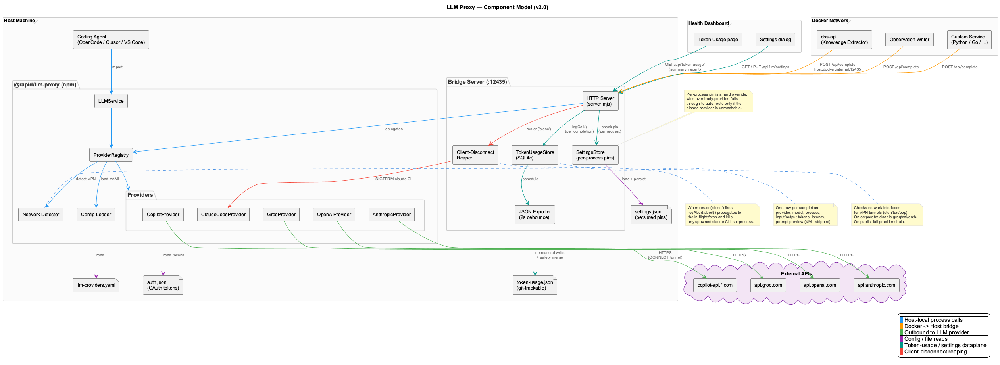
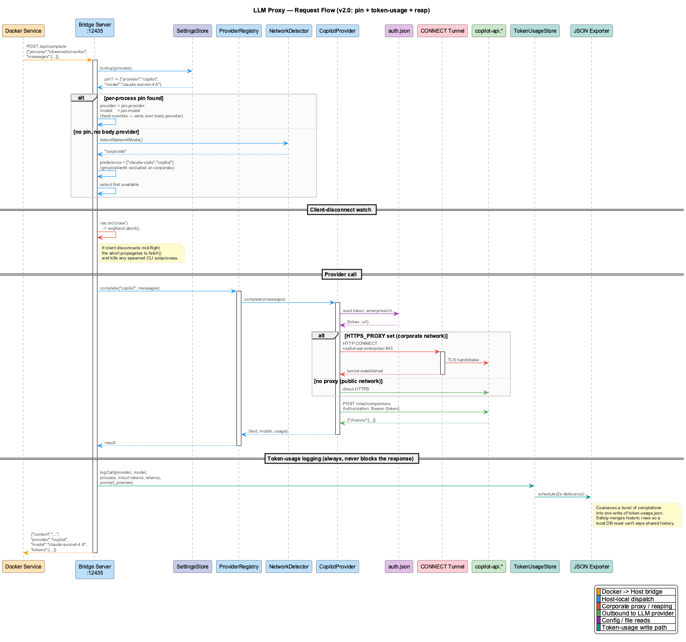

# Architecture

Component overview for `@rapid/llm-proxy`.

## High-Level Overview


The system has two main usage modes:

1. **npm package** — import `LLMService` into a Node.js application for direct in-process LLM calls
2. **HTTP proxy bridge** — a standalone HTTP server that exposes LLM completions over HTTP, used by Docker containers or other processes that cannot call providers directly

## Component Model



### LLMService

The single public entry point (`src/llm-service.ts`). All LLM operations go through this class.

Responsibilities:
- Mode routing (mock / local / public)
- Response caching via `LLMCache`
- Circuit breaker integration via `CircuitBreaker`
- Budget and sensitivity checks (dependency-injected)
- Subscription quota tracking for zero-cost providers
- Provider chain resolution and failover
- JSON response validation with Zod schemas
- Markdown fence stripping and truncated JSON repair
- Per-call token-usage logging to SQLite (`TokenUsageStore`) and debounced JSON export

Key methods:
- `complete(request)` — main completion with full routing
- `completeForTask(prompt, taskType)` — convenience with task-based tier resolution
- `completeWithRouting(prompt, routingKey)` — explicit operation-type routing
- `initialize(configPath?)` — load YAML config, register providers
- `updateProviderPriority(priority)` — runtime priority changes (e.g. from dashboard)

### ProviderRegistry

Manages provider lifecycle and chain resolution (`src/provider-registry.ts`).

Responsibilities:
- Auto-register all providers at startup (with 10s init timeout per provider)
- Detect network mode (VPN vs public) and apply config overrides
- Skip unreachable providers on VPN (external API providers hang in SYN_SENT)
- Resolve ordered provider chains for requests based on tier, task type, and agent overrides
- Expose available providers and local providers

Tier resolution order:
1. Explicit `request.tier`
2. `SEMANTIC_ANALYSIS_TIER` env var
3. Task-specific env var (`<TASK_TYPE>_TIER`)
4. `agentOverrides[agentId]` from config
5. `taskTiers` mapping from config
6. Default: `standard`

### Providers

All providers extend `BaseProvider` (`src/providers/base-provider.ts`) which implements the `LLMProvider` interface:

```typescript
interface LLMProvider {
  readonly name: ProviderName;
  readonly isLocal: boolean;
  isAvailable(): boolean;
  initialize(): Promise<void>;
  complete(request: LLMCompletionRequest): Promise<LLMCompletionResult>;
  getModels(): Partial<Record<ModelTier, string>>;
}
```

Provider types reachable through the proxy bridge:

| Provider | Method | Local? | Notes |
|----------|--------|--------|-------|
| `copilot` | HTTP | No | Direct HTTP to Copilot API, CONNECT tunnel for corporate proxy |
| `claude-code` | CLI | No | Shells out to `claude` CLI, uses personal OAuth subscription; two-tier dispatch via the **Claude CLI Worker Pool** |
| `groq` | HTTP | No | API key, fast inference (env-gated, skipped on VPN) |
| `openai` | HTTP | No | API key (env-gated, skipped on VPN) |
| `anthropic` | HTTP | No | API key (env-gated, skipped on VPN) |

Additional providers the npm package supports outside the bridge:

| Provider | Method | Local? | Notes |
|----------|--------|--------|-------|
| `gemini` | SDK | No | API key |
| `github-models` | SDK | No | GitHub token, OpenAI-compatible |
| `dmr` | HTTP | Yes | Docker Model Runner (local models) |
| `ollama` | HTTP | Yes | Local Ollama instance |
| `mock` | In-memory | Yes | Injected mock service for testing |
| `proxy` | HTTP | No | Routes through the proxy bridge server |

See [providers.md](providers.md) for per-provider details.

### Claude CLI Worker Pool

A pool of persistent `claude` CLI subprocesses that serves `claude-code` completions on the bridge (`proxy-bridge/worker-pool.mjs`, wired into `proxy-bridge/server.mjs`). It replaces the previous cold-start-per-request model with a warm, reusable two-tier dispatch.

Cold-starting `claude -p` for every completion cost ~10–14 s per call (process launch + auth load + model warm-up). The worker pool amortizes that by keeping authenticated, model-warmed subprocesses alive between requests, dropping the common case to ~2–3 s.

`copilot` is **not** pooled — it is a direct HTTP provider with no subprocess to keep warm, so it bypasses the pool entirely.

#### WorkerPool and ClaudeWorker

- **`WorkerPool`** — owns the pool registry, request routing, and lifecycle. Its public surface is `complete(body, abortSignal, overflowFn)`: it picks (or lazily spawns) a worker for the request's key, or hands off to `overflowFn` when no warm slot is available.
- **`ClaudeWorker`** — wraps one persistent `claude -p --input-format stream-json --output-format stream-json` subprocess. Each worker is **concurrency-1** with its own **FIFO queue**, so a worker processes one request at a time and queues the rest in arrival order.

#### Keying — (model × system prompt)

Workers are keyed by `` `${model} :: ${sha256(systemPrompt).slice(0, 16)}` ``. Two requests share a warm worker only if they use the same model **and** the same system prompt — because the system prompt is established once on the persistent stream and cannot change mid-worker without a respawn. An LRU prompt-cap (`LLM_PROXY_WORKER_PROMPT_CAP`, default `8`) bounds the number of distinct keyed pools so an unbounded variety of system prompts cannot spawn unbounded workers; the least-recently-used pool is evicted past the cap. Each key holds up to `LLM_PROXY_WORKER_POOL_SIZE` (default `2`) workers.

#### Two-tier dispatch — warm worker vs execFile overflow

| Tier | Path | Latency | When |
|------|------|---------|------|
| **Tier 1 (warm)** | `WorkerPool.complete()` → persistent stream-JSON worker | ~2–3 s | Default; a warm or lazily-spawnable worker is available for the key |
| **Tier 2 (overflow)** | `completeClaudeCodeViaCLI` → cold one-shot `execFile claude -p` | ~10–14 s | All workers for the key are busy, the key is in crash-cooldown, or `LLM_PROXY_DISABLE_WORKER_POOL=1` |

Tier 2 is the same verbatim one-shot CLI path used before the pool existed, so overflow is always safe — it never queues behind a wedged worker.

#### Lifecycle

The pool is designed to behave well under boot, idleness, crashes, and cancellation (verification suite WLIFE-01..04):

- **Lazy spawn (WLIFE-01)** — zero workers exist at boot. The first request for a key spawns its worker on demand; keys that are never requested cost nothing.
- **Idle eviction (WLIFE-02)** — an `unref`'d idle timer (default `LLM_PROXY_WORKER_IDLE_MS` = 30 min) disposes a worker that has gone quiet, freeing the subprocess. Because the timer is `unref`'d it never keeps the process alive on its own. The next request for that key lazily respawns a fresh worker.
- **Crash recovery (WLIFE-03)** — if a worker subprocess dies, its in-flight and queued jobs surface a `RETRYABLE` error rather than hanging. A **per-key crash-cooldown** guards against respawn storms: after `LLM_PROXY_WORKER_CRASH_THRESHOLD` (default `3`) crashes within `LLM_PROXY_WORKER_CRASH_WINDOW_MS` (default `60000` ms), that key is routed to the Tier 2 overflow path instead of respawning, until the cooldown elapses.
- **Cancellation (WLIFE-04)** — a client abort on the request's `AbortSignal` is handled by position:
  - If the aborted job is **in-flight**, the worker is `SIGTERM`'d, disposed, and dropped synchronously (the stream cannot be cleanly rewound, so the whole worker is discarded).
  - If the aborted job is still **queued**, only that job is dequeued; the worker and the rest of its queue are untouched.

#### Worker recycling and timeouts

Even without crashes, workers are retired proactively to bound resource drift:

| Variable | Default | Effect |
|----------|---------|--------|
| `LLM_PROXY_WORKER_POOL_SIZE` | `2` | Max warm workers per (model × system-prompt) key |
| `LLM_PROXY_WORKER_PROMPT_CAP` | `8` | LRU cap on distinct keyed pools |
| `LLM_PROXY_WORKER_IDLE_MS` | `1800000` (30 min) | Idle eviction timeout (`unref`'d timer) |
| `LLM_PROXY_WORKER_MAX_REQUESTS` | `50` | Recycle a worker after this many completions |
| `LLM_PROXY_WORKER_MAX_INPUT_TOKENS` | `150000` | Recycle a worker after this much cumulative input |
| `LLM_PROXY_WORKER_REQUEST_TIMEOUT_MS` | `120000` | Per-request timeout inside a worker |
| `LLM_PROXY_WORKER_CRASH_THRESHOLD` | `3` | Crashes within the window that trip crash-cooldown |
| `LLM_PROXY_WORKER_CRASH_WINDOW_MS` | `60000` | Sliding window for the crash threshold |
| `LLM_PROXY_DISABLE_WORKER_POOL` | `0` | Set `1` to send all `claude-code` requests straight to Tier 2 |

### TokenUsageStore

Per-instance SQLite database (`src/token-usage.ts`) opened at the path resolved from `LLM_PROXY_TOKEN_DB_PATH` (or `$LLM_PROXY_DATA_DIR/llm-proxy/token-usage.db`).

Responsibilities:
- Single `token_usage` table — one row per completion with `provider`, `model`, `process`, `subscription`, `input_tokens`, `output_tokens`, `total_tokens`, `latency_ms`, `prompt_preview`
- `logCall()` is best-effort and never throws into the request hot path; failure to log must not fail the LLM call
- Debounced JSON export (`exportToJson`, 2 s coalescing window) writes `$LLM_PROXY_DATA_DIR/llm-proxy-export/token-usage.json`
- **Safety merge:** if the on-disk JSON has rows whose IDs are missing from the live DB (because the DB was reset locally), those historic rows are preserved when writing back — mirrors `ObservationExporter._mergeWithExisting`
- Read API: `getSummary({ hours, bucketMinutes })` returns per-provider/per-process totals plus a zero-filled bucketed timeline; `getRecent({ limit })` returns latest N rows

The DB stays untracked in git; the JSON snapshot is what teammates commit. This is the same dual-store contract used by LevelDB (graph) and observations elsewhere in the consumer project.

### SettingsStore

Per-process provider/model pin map (`proxy-bridge/server.mjs`, persisted alongside the token-usage DB).

- `GET /api/llm/settings` → `{ settings, processes, availableProviders, allProviders }`
- `PUT /api/llm/settings` replaces the settings document atomically
- A pin in `settings[process]` becomes a **hard override** in routing — wins over `body.provider`, falls through to auto-route only if the pinned provider is unreachable

### Client-disconnect reaper

The bridge server listens for `res` `close` events. When a client disconnects mid-completion (browser tab close, `obs-api` SIGTERM, etc.), it calls `reqAbort.abort()`, which:

1. Aborts the in-flight `fetch()` to the provider
2. Kills any spawned `claude` CLI subprocess (`SIGTERM`, then `SIGKILL` after grace period) — for pooled requests this is the worker pool's cancellation path (WLIFE-04 above)
3. Stops the completion handler before it writes a half-built response

Without this, a single SIGTERM on the consumer process would leave a long-running `claude -p` subprocess orphaned for minutes.

### CircuitBreaker

Per-provider failure tracking with exponential backoff (`src/circuit-breaker.ts`).

- Opens after `threshold` consecutive failures (default: 5)
- Exponential backoff on reset timeout (base 60s, max 30min)
- Half-open state: allows one retry after backoff expires
- Single success fully resets failure count and backoff
- `tripImmediately()` for auth errors (skips threshold)

### LLMCache

LRU cache with TTL for response deduplication (`src/cache.ts`).

- Content-hash keys (prompt + operationType)
- FIFO eviction at `maxSize` (default: 1000)
- TTL expiry (default: 1 hour)
- Hit/miss/rate stats

### Network Detection

Detects VPN/corporate network vs public network (`src/network-detect.ts`). See [network-detection.md](network-detection.md).

### Proxy Bridge Server

Standalone HTTP server for container-to-host LLM routing (`proxy-bridge/server.mjs`). See [proxy-bridge.md](proxy-bridge.md).

## Request Flow



1. Consumer calls `llm.complete(request)` (or `POST /api/complete` on the bridge)
2. LLMService resolves mode (mock → local → public)
3. For public mode: check cache → check sensitivity → check budget → check subscription quotas
4. Bridge checks `SettingsStore` for a per-process pin (`body.process`) — pin wins over `body.provider`
5. ProviderRegistry resolves provider chain based on pin, tier, task, network mode
6. Walk chain: skip circuit-broken providers, try each until one succeeds
7. For `claude-code`: dispatch through the worker pool (Tier 1 warm worker); overflow to the cold `execFile` CLI path (Tier 2) when workers are busy, the key is in crash-cooldown, or `LLM_PROXY_DISABLE_WORKER_POOL=1`. `copilot` and the API providers go direct.
8. On success: record metrics, log row to `TokenUsageStore`, schedule JSON export, cache result, validate schema if provided
9. On failure: record in circuit breaker, try next provider
10. On client-disconnect (`res` `close` event): `reqAbort.abort()` kills the in-flight fetch and any spawned/pooled CLI subprocess
11. If all fail: throw error


## Deployment


Two deployment scenarios:

**Host-side (direct):** Application imports `@rapid/llm-proxy` as npm dependency. Providers call APIs directly. Network detection determines which providers are reachable.

**Docker (via proxy bridge):** Container sets `LLM_CLI_PROXY_URL=http://host.docker.internal:8089`. The `ProxyProvider` or individual providers route through the bridge server running on the host.


