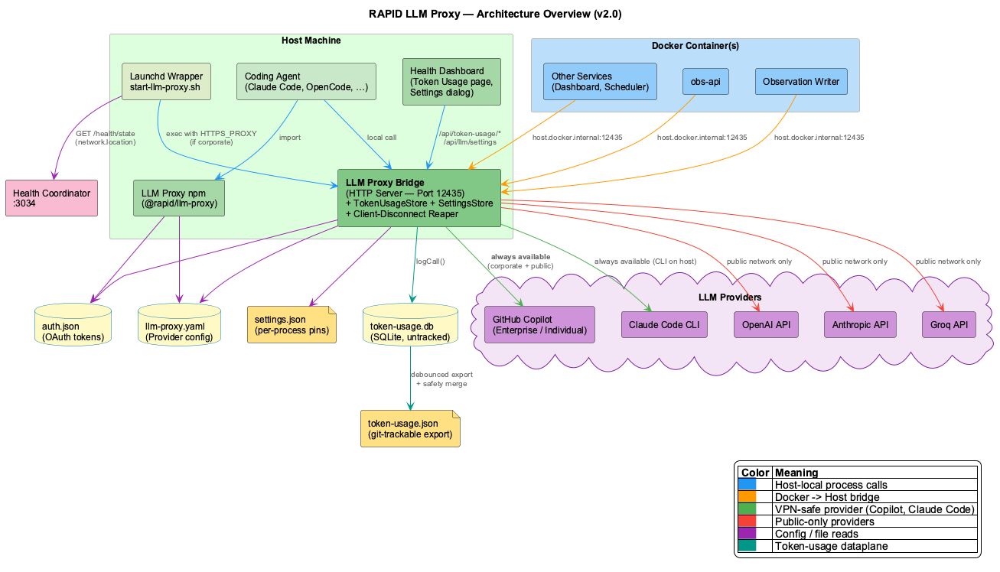
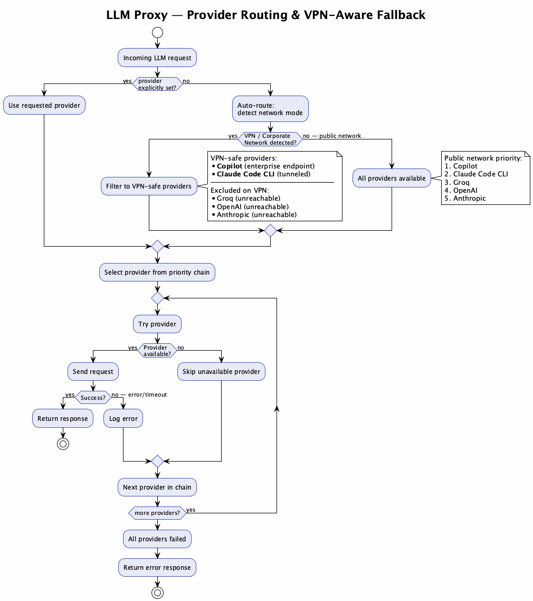
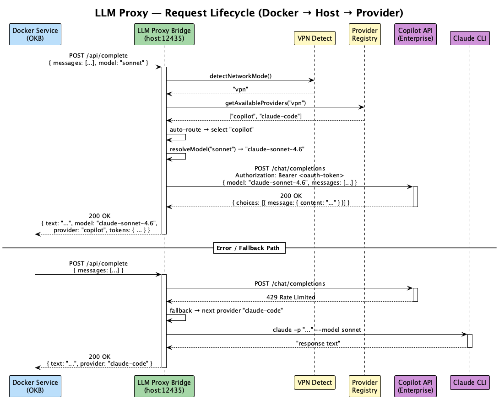

# RAPID LLM Proxy — Integration Manual

A unified LLM gateway that routes requests to multiple providers with automatic fallback, VPN-aware network detection, and zero-config Docker support.

## Architecture



The proxy runs on the **host machine** and exposes an HTTP API. Consumers — whether running directly on the host or inside Docker containers — send OpenAI-compatible requests to a single endpoint. The proxy handles provider selection, authentication, model mapping, and failover transparently.

### Key Design Principles

- **Single entry point**: All LLM calls go through `POST /api/complete` — consumers never talk to providers directly
- **Network-aware routing**: VPN/corporate network detection automatically excludes unreachable providers
- **Fallback chains**: If the primary provider fails, the proxy tries the next one in the chain
- **Zero-config for Docker**: Containers reach the proxy via `host.docker.internal` — no API keys needed inside containers

## Provider Routing



### Supported Providers

| Provider | Transport | Auth | VPN-Safe | Notes |
|----------|-----------|------|----------|-------|
| `copilot` | HTTPS to enterprise/individual endpoint | OAuth token from `auth.json` | Yes | Supports enterprise GitHub (custom domain) |
| `claude-code` | CLI subprocess (`claude -p`) | Claude Max subscription | Depends | Works if CLI has tunnel; subject to concurrency limits |
| `groq` | HTTPS to `api.groq.com` | `GROQ_API_KEY` | No | Fast inference, free tier available |
| `openai` | HTTPS to `api.openai.com` | `OPENAI_API_KEY` | No | GPT-4o, GPT-4 Turbo |
| `anthropic` | HTTPS to `api.anthropic.com` | `ANTHROPIC_API_KEY` | No | Claude Sonnet/Opus via direct API |

### VPN Detection

The proxy detects VPN/corporate networks by:

1. Checking for `utun`, `tun`, `ppp` network interfaces (common VPN adapters)
2. Optionally probing a configurable host (`LLM_VPN_PROBE_HOST` env var)

On VPN, only `copilot` and `claude-code` are tried. On public networks, all providers are available in priority order.

## Request Lifecycle



## Installation

### As an npm Package (Library)

```bash
npm install @anthropic/rapid-llm-proxy
# or from tarball
npm install ./vendor/rapid-llm-proxy-1.0.0.tgz
```

```javascript
import { LLMService } from '@anthropic/rapid-llm-proxy';

const llm = new LLMService();
await llm.initialize();

const result = await llm.complete({
  messages: [{ role: 'user', content: 'Summarize this text...' }],
  model: 'sonnet'
});
console.log(result.text);
```

### As a Bridge Server (HTTP API)

```bash
# Start the proxy
cd rapid-llm-proxy
LLM_PROXY_PORT=12435 node dist/proxy-bridge/server.mjs

# Or with pm2
pm2 start dist/proxy-bridge/server.mjs --name llm-proxy \
  --env LLM_PROXY_PORT=12435
```

The bridge server exposes:

| Endpoint | Method | Description |
|----------|--------|-------------|
| `/api/complete` | POST | LLM completion (main endpoint) |
| `/health` | GET | Provider status, network mode, uptime |

## Docker Integration


### Docker Compose Setup

```yaml
services:
  my-service:
    image: my-app:latest
    extra_hosts:
      - "host.docker.internal:host-gateway"
    environment:
      - LLM_PROXY_URL=http://host.docker.internal:12435
```

### Calling from a Container

```bash
# Simple curl from inside a container
curl -s http://host.docker.internal:12435/api/complete \
  -H "Content-Type: application/json" \
  -d '{
    "messages": [{"role": "user", "content": "Hello"}]
  }'
```

```javascript
// Node.js inside a container
const response = await fetch(`${process.env.LLM_PROXY_URL}/api/complete`, {
  method: 'POST',
  headers: { 'Content-Type': 'application/json' },
  body: JSON.stringify({
    messages: [{ role: 'user', content: 'Summarize...' }]
  })
});
const result = await response.json();
```

No API keys, no auth tokens, no provider SDKs needed inside the container — the proxy on the host handles everything.

## Configuration

### YAML Configuration (`llm-proxy.yaml`)

The proxy reads configuration from `~/.config/rapid-llm-proxy/llm-proxy.yaml`:

```yaml
llm_proxy:
  # Provider priority (tried in order)
  provider_priority:
    - copilot
    - claude-code
    - groq
    - openai
    - anthropic

  # Network-aware overrides
  network_overrides:
    vpn:
      provider_priority:
        - copilot
        - claude-code
      description: "Corporate VPN — only tunneled providers"
    public:
      provider_priority:
        - copilot
        - claude-code
        - groq
        - openai
        - anthropic
      description: "Public network — all providers available"

  # Provider-specific settings
  providers:
    copilot:
      enterprise_url: "your-github-enterprise.example.com"  # optional
      models:
        - gpt-4o
        - claude-sonnet-4.6
    claude-code:
      models:
        - sonnet
        - opus
    groq:
      models:
        - llama-3.3-70b-versatile
        - mixtral-8x7b-32768
    openai:
      models:
        - gpt-4o
        - gpt-4-turbo
    anthropic:
      models:
        - claude-sonnet-4-20250514
        - claude-opus-4-20250514
```

### Environment Variables

| Variable | Default | Description |
|----------|---------|-------------|
| `LLM_PROXY_PORT` | `8089` | Bridge server port |
| `LLM_PROXY_CONFIG` | `~/.config/rapid-llm-proxy/llm-proxy.yaml` | Config file path |
| `HTTPS_PROXY` | — | HTTP CONNECT proxy for outbound HTTPS (auto-detected) |
| `LLM_VPN_PROBE_HOST` | — | Host to probe for VPN detection (e.g., `intranet.example.com`) |
| `GROQ_API_KEY` | — | Groq API key |
| `OPENAI_API_KEY` | — | OpenAI API key |
| `ANTHROPIC_API_KEY` | — | Anthropic API key |
| `LLM_PROXY_INIT_TIMEOUT` | `10000` | Provider init timeout in ms |

### Auth Token Location

Copilot OAuth tokens are read from the coding agent's auth store:

```
~/.local/share/opencode/auth.json   # OpenCode
~/.config/github-copilot/hosts.json # GitHub Copilot
```

The proxy auto-detects which file exists and extracts the OAuth token and enterprise URL.

## API Reference

### POST /api/complete

**Request:**

```json
{
  "messages": [
    { "role": "system", "content": "You are a helpful assistant." },
    { "role": "user", "content": "Explain VPN detection." }
  ],
  "provider": "copilot",
  "model": "sonnet",
  "stream": false,
  "temperature": 0.3,
  "max_tokens": 2048
}
```

All fields except `messages` are optional:
- **`provider`**: Force a specific provider. If omitted, auto-route selects the best available.
- **`model`**: Model alias (e.g., `sonnet`, `gpt-4o`). Mapped to provider-specific names.
- **`stream`**: Enable Server-Sent Events streaming (default: `false`).
- **`temperature`**: Sampling temperature (default: provider-specific).
- **`max_tokens`**: Maximum response tokens (default: `4096`).

**Response:**

```json
{
  "text": "VPN detection works by checking network interfaces...",
  "model": "claude-sonnet-4.6",
  "provider": "copilot",
  "tokens": {
    "prompt": 24,
    "completion": 156,
    "total": 180
  },
  "duration_ms": 1423
}
```

**Error Response:**

```json
{
  "error": "All providers failed",
  "details": [
    { "provider": "copilot", "error": "401 Unauthorized" },
    { "provider": "claude-code", "error": "CLI timeout after 120s" }
  ]
}
```

### GET /health

```json
{
  "status": "ok",
  "uptime": 3600,
  "network_mode": "vpn",
  "providers": {
    "copilot": { "available": true, "models": ["gpt-4o", "claude-sonnet-4.6"] },
    "claude-code": { "available": true, "models": ["sonnet", "opus"] },
    "groq": { "available": false, "reason": "excluded on VPN" },
    "openai": { "available": false, "reason": "excluded on VPN" },
    "anthropic": { "available": false, "reason": "excluded on VPN" }
  }
}
```

## Model Mapping

The proxy maps short aliases to provider-specific model names:

| Alias | Copilot | Claude CLI | Groq | OpenAI | Anthropic |
|-------|---------|------------|------|--------|-----------|
| `sonnet` | `claude-sonnet-4.6` | `sonnet` | — | — | `claude-sonnet-4-20250514` |
| `opus` | — | `opus` | — | — | `claude-opus-4-20250514` |
| `gpt-4o` | `gpt-4o` | — | — | `gpt-4o` | — |
| `llama-70b` | — | — | `llama-3.3-70b-versatile` | — | — |

If no model is specified, the provider's default is used.

## Troubleshooting

### Provider shows "unavailable"

Check `/health` for the specific error. Common causes:
- **Copilot**: Expired OAuth token → re-authenticate with your coding agent
- **Claude Code**: CLI not installed or not authenticated → run `claude` once manually
- **API providers**: Missing API key env var or network unreachable (VPN)

### All providers timeout on VPN

Ensure `HTTPS_PROXY` is set if your corporate network requires a proxy for outbound HTTPS. The proxy uses an HTTP CONNECT tunnel for Copilot requests.

### Docker container can't reach proxy

1. Verify `extra_hosts: ["host.docker.internal:host-gateway"]` in compose
2. Verify the proxy listens on `0.0.0.0` (not `127.0.0.1`)
3. Test: `docker exec <container> curl http://host.docker.internal:12435/health`

### Claude CLI hangs

The `claude` CLI has a session concurrency limit. If a coding session is active, CLI calls from the proxy queue behind it. Workarounds:
- Use `copilot` as primary provider (recommended)
- Set `LLM_PROXY_INIT_TIMEOUT=10000` to fail fast and fall back

### Duplicate observations

If the observation writer creates near-duplicate entries, the proxy's consumer should debounce — wait for the conversation turn to settle before requesting a summary.
