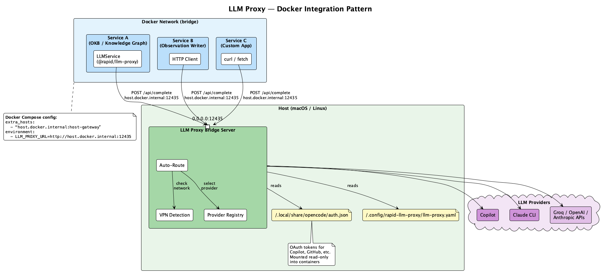

# Proxy Bridge

The proxy bridge is a standalone HTTP server (`proxy-bridge/server.mjs`) that runs on the host and provides LLM completions, token-usage telemetry, and per-process routing settings to Docker containers or other processes that cannot call providers directly.



## Starting the server

```bash
# Default port 8089
node proxy-bridge/server.mjs

# Via npx
npx llm-proxy

# Custom port
LLM_PROXY_PORT=12435 node proxy-bridge/server.mjs

# Via launchd wrapper (auto-injects HTTPS_PROXY on corporate networks)
./bin/start-llm-proxy.sh
```

The server listens on `0.0.0.0` so it is accessible from Docker containers. The conventional launchd port in the consumer project is `12435`.

## API summary

| Method | Path | Purpose |
|--------|------|---------|
| `POST` | `/api/complete` | Chat completion (auto-route or explicit provider) |
| `GET` | `/health` | Provider availability + detected network mode |
| `GET` | `/api/token-usage/summary` | Per-provider/per-process totals + zero-filled timeline |
| `GET` | `/api/token-usage/recent` | Latest N call rows with prompt preview |
| `GET` | `/api/llm/settings` | Current per-process pins, available providers, distinct processes seen |
| `PUT` | `/api/llm/settings` | Replace per-process pin map atomically |

## `GET /health`

Returns provider availability and network mode.

```bash
curl http://localhost:12435/health
```

```json
{
  "status": "ok",
  "mode": "direct-http+cli",
  "networkMode": "corporate",
  "providers": {
    "anthropic": { "available": false, "method": "http" },
    "claude-code": { "available": true,  "method": "cli" },
    "copilot":     { "available": true,  "method": "http" },
    "groq":        { "available": false, "method": "http" },
    "openai":      { "available": false, "method": "http" }
  }
}
```

On VPN, `groq`/`openai`/`anthropic` typically report `available: false` because they were skipped at init time.

## `POST /api/complete`

Chat completion endpoint. Returns a single JSON response (no streaming on the bridge).

**Request body:**

| Field | Type | Required | Description |
|-------|------|----------|-------------|
| `messages` | `Array<{role, content}>` | Yes | Chat messages |
| `process` | `string` | No | Logical consumer name (e.g. `observation-writer`). Logged to `token_usage` and used as the key for `/api/llm/settings` pins. |
| `provider` | `string` | No | Force a provider (`copilot`, `claude-code`, `openai`, `groq`, `anthropic`). Per-process pins win over this field. |
| `model` | `string` | No | Model name or alias (`sonnet`, `claude-sonnet-4.6`, …) |
| `maxTokens` | `number` | No | Max output tokens (default: 4096) |
| `temperature` | `number` | No | Sampling temperature |
| `timeout` | `number` | No | Request timeout in ms |
| `responseFormat` | `{type: "json_object"}` | No | Request JSON output |

**Example:**

```bash
curl -X POST http://localhost:12435/api/complete \
  -H 'Content-Type: application/json' \
  -d '{
    "process": "observation-writer",
    "messages": [
      {"role": "system", "content": "You are a helpful assistant."},
      {"role": "user", "content": "What is 2+2?"}
    ],
    "maxTokens": 256
  }'
```

**Response (200):**

```json
{
  "content": "2 + 2 = 4",
  "provider": "copilot",
  "model": "claude-sonnet-4.6",
  "tokens": { "input": 25, "output": 8, "total": 33 },
  "latencyMs": 2340
}
```

**Error responses:**

| Status | Type | Meaning |
|--------|------|---------|
| 400 | — | Invalid JSON or unknown provider |
| 401 | `AUTH_ERROR` | Provider auth failed |
| 404 | `PROVIDER_UNAVAILABLE` | Requested provider not available |
| 429 | `QUOTA_EXHAUSTED` | Rate limited |
| 499 | `CLIENT_DISCONNECTED` | Client gave up before the response was ready; subprocess was reaped |
| 500 | `API_ERROR` | Provider API error |

### Claude CLI worker-pool dispatch (claude-code only)

When a `/api/complete` request resolves to the `claude-code` provider, the bridge does **not** cold-start a fresh `claude` CLI per request. It routes through a two-tier dispatch backed by the **Claude CLI Worker Pool** (`proxy-bridge/worker-pool.mjs`):

| Tier | Path | Latency | When it serves the request |
|------|------|---------|----------------------------|
| **Tier 1 — warm** | `WorkerPool.complete()` → a persistent `claude -p --input-format stream-json --output-format stream-json` worker, reused warm | ~2–3 s | Default. A warm worker exists for the request's (model × system-prompt) key, or one can be lazily spawned. |
| **Tier 2 — overflow** | `completeClaudeCodeViaCLI` → a cold one-shot `execFile claude -p` per request | ~10–14 s | All warm workers for the key are busy, **or** the key is in crash-cooldown, **or** `LLM_PROXY_DISABLE_WORKER_POOL=1`. |

Workers are keyed by `model :: sha256(systemPrompt)[:16]` — a warm worker is reused only when both the model and the system prompt match, because the system prompt is fixed on the persistent stream. Each worker is concurrency-1 with a FIFO queue; the pool spawns workers lazily (none exist at boot) and evicts them after an idle period. The Tier 2 overflow is the verbatim one-shot CLI path that predates the pool, so it is always available as a safe fallback and never queues behind a busy worker.

`copilot` (and the API providers `openai` / `groq` / `anthropic`) stay **direct HTTP** — they are not pooled, because there is no subprocess to keep warm.

The worker pool is transparent to callers: request and response shapes are unchanged whether a request was served by Tier 1 or Tier 2. See [architecture.md](architecture.md#claude-cli-worker-pool) for the full component model, lifecycle (lazy spawn, idle eviction, crash cooldown, cancellation), and tuning environment variables.

### Client-disconnect reaping

The bridge listens for `res` `close` events on every `/api/complete` request. If the HTTP client disconnects mid-completion — browser tab close, `obs-api` getting `SIGTERM`, a curl `Ctrl-C` — the bridge:

1. Calls `reqAbort.abort()`, which propagates to the in-flight `fetch()`
2. Kills any spawned `claude` CLI subprocess (`SIGTERM`, then `SIGKILL` after the grace period) — for a pooled Tier 1 request this is the worker pool's cancellation path: an in-flight worker is `SIGTERM`'d and disposed, a still-queued job is simply dequeued
3. Stops the completion handler before writing a half-built response

Without this, a single `SIGTERM` on the consumer process orphaned a `claude -p` subprocess that kept running for minutes. The reaper turns short-lived consumer lifecycles into clean cascades.

## `GET /api/token-usage/summary`

Per-provider/per-process totals plus a zero-filled bucketed timeline.

**Query params:**

| Param | Default | Description |
|-------|---------|-------------|
| `hours` | `24` | Time window (most recent `hours` from now) |
| `bucketMinutes` | `2` | Timeline bucket width in minutes; gaps zero-filled in JS |

```bash
curl 'http://localhost:12435/api/token-usage/summary?hours=24&bucketMinutes=2' | jq
```

```json
{
  "totals": { "calls": 1335, "inputTokens": 2320000, "outputTokens": 178600, "avgLatencyMs": 8230 },
  "byProvider": [
    { "provider": "claude-code", "calls": 389, "inputTokens": 1900000, "outputTokens": 96000 },
    { "provider": "copilot",     "calls": 946, "inputTokens":  420000, "outputTokens": 82600 }
  ],
  "byProcess": [
    { "process": "observation-writer",   "calls": 592, "totalTokens": 2100000, "share": 0.832 },
    { "process": "consolidator-digest",  "calls":  16, "totalTokens":  186900, "share": 0.075 },
    { "process": "consolidator-insight", "calls":   3, "totalTokens":  100800, "share": 0.040 }
  ],
  "timeline": [
    { "ts": "2026-05-15T18:00:00Z", "input": 12400, "output":  860 },
    { "ts": "2026-05-15T18:02:00Z", "input":     0, "output":    0 },
    { "ts": "2026-05-15T18:04:00Z", "input": 35200, "output": 2200 }
  ]
}
```

The zero-filled timeline lets a dashboard plot a continuous chart without inventing missing buckets in the renderer.

## `GET /api/token-usage/recent`

Latest N call rows.

```bash
curl 'http://localhost:12435/api/token-usage/recent?limit=50' | jq '.[0]'
```

```json
{
  "id": 18342,
  "timestamp": "2026-05-15T19:24:01.412Z",
  "process": "observation-writer",
  "provider": "copilot",
  "model": "Claude Sonnet 4.6",
  "input_tokens": 2700,
  "output_tokens": 142,
  "latency_ms": 5100,
  "prompt_preview": "coding # Session Logs (/sl) — Session Continuity Command Load and …"
}
```

`prompt_preview` has any leading XML wrapper tags (`<system-prompt>`, `<task>`, etc.) stripped so the dashboard preview column reads cleanly.

## `GET / PUT /api/llm/settings`

Per-process provider/model pins.

```bash
# Read
curl http://localhost:12435/api/llm/settings | jq
```

```json
{
  "settings": {
    "observation-writer": { "provider": "copilot", "model": "claude-sonnet-4.6" }
  },
  "processes": ["observation-writer", "consolidator-digest", "health-coordinator", "reap-test", "..."],
  "availableProviders": ["claude-code", "copilot"],
  "allProviders": ["claude-code", "copilot", "openai", "groq", "anthropic"]
}
```

```bash
# Write
curl -X PUT http://localhost:12435/api/llm/settings \
  -H 'Content-Type: application/json' \
  -d '{"observation-writer":{"provider":"copilot","model":"claude-sonnet-4.6"}}'
```

A pinned `process` becomes a **hard override** in routing — wins over the `body.provider` field, falls through to auto-route only if the pinned provider is unreachable at request time.

## JSON export

Every `logCall()` schedules a debounced (2 s) write to `$LLM_PROXY_DATA_DIR/llm-proxy-export/token-usage.json`. The DB stays untracked in git; the JSON snapshot is what teammates commit and `git pull`. On startup the bridge will merge existing JSON rows back into the DB if it was wiped locally — see `src/token-usage.ts:exportToJson` for the safety-merge logic.

This mirrors the dual-store contract used elsewhere in the consumer project for the LevelDB knowledge graph and the observations DB.

## Auto-routing

When no `provider` is specified and no per-process pin exists, the bridge selects the first available provider based on network mode:

| Network mode | Priority order |
|-------------|----------------|
| **public** | claude-code → copilot → groq → openai → anthropic |
| **corporate/vpn** | claude-code → copilot |

`claude-code` is excluded from VPN routing if `claude auth` cannot reach its auth server through the corporate proxy; in that case the bridge falls through to `copilot` automatically. When a request does land on `claude-code`, it is dispatched through the worker pool (Tier 1) with cold-CLI overflow (Tier 2) as described under [`POST /api/complete`](#claude-cli-worker-pool-dispatch-claude-code-only).

Network mode is detected once at startup and cached for 5 minutes — see [network-detection.md](network-detection.md).

## Provider implementations in the bridge

| Provider | Method | Init check |
|----------|--------|------------|
| **copilot** | Direct HTTP to Copilot API | Fetches `/models` endpoint with OAuth token |
| **claude-code** | `claude` CLI subprocess (worker pool, Tier 1) + cold `execFile` overflow (Tier 2) | Runs `claude auth status` |
| **openai** | Direct HTTP to OpenAI Messages API | Tiny ping request (skipped on VPN) |
| **groq** | Direct HTTP to Groq Chat Completions API | Tiny ping request (skipped on VPN) |
| **anthropic** | Direct HTTP to Anthropic Messages API | Tiny ping request (skipped on VPN) |

### Copilot in the bridge

- Reads OAuth tokens from `~/.local/share/opencode/auth.json`
- Watches the auth file for changes (token refresh)
- Uses `undici` ProxyAgent when `HTTPS_PROXY` is set (injected by the launchd wrapper on corporate)
- Derives API base URL from `enterpriseUrl` in `auth.json`
- Per-prompt header sanitization avoids leaking API keys into the corporate proxy
- Direct HTTP — **not** routed through the Claude CLI worker pool

### Claude Code in the bridge

- **Tier 1 (warm):** served by the worker pool — a persistent `claude -p --input-format stream-json --output-format stream-json` subprocess kept warm and reused per (model × system-prompt) key (~2–3 s)
- **Tier 2 (overflow):** spawns `claude -p -- <prompt> --output-format json --model <model> --tools "" --no-session-persistence` as a one-shot when workers are busy, the key is in crash-cooldown, or `LLM_PROXY_DISABLE_WORKER_POOL=1` (~10–14 s)
- `--` terminator means prompts starting with `-` no longer crash the CLI
- `ANTHROPIC_API_KEY` is removed from subprocess env so the CLI uses the OAuth subscription
- CLI path: `CLAUDE_CLI_PATH` env var or `/opt/homebrew/bin/claude`
- 10 MB max buffer for large responses (overflow path)
- Reaped by `reqAbort.abort()` when the HTTP client disconnects (worker pool cancellation for Tier 1, child kill for Tier 2)
- See [architecture.md](architecture.md#claude-cli-worker-pool) for lifecycle and tuning env vars

### OpenAI / Groq / Anthropic in the bridge

- Pure HTTP, no SDK (so the bridge has no SDK-version coupling and can run on Node-only)
- Env-gated: only initialized if their `*_API_KEY` env var is non-empty
- Skipped at init time on corporate networks

## Docker networking

From a Docker container, reach the bridge via:

```
http://host.docker.internal:12435
```

Docker Compose config:

```yaml
services:
  app:
    environment:
      - LLM_PROXY_URL=http://host.docker.internal:12435
    extra_hosts:
      - "host.docker.internal:host-gateway"
```

The `extra_hosts` entry is required on Linux. On macOS, `host.docker.internal` is available by default.

## Corporate proxy support

When `HTTPS_PROXY` is set, the bridge uses `undici.ProxyAgent` for all outbound HTTPS requests (Copilot API, OpenAI/Groq/Anthropic if reachable). The launchd wrapper at `bin/start-llm-proxy.sh` injects this automatically when the health coordinator (or PAC-host probe fallback) detects a corporate network — see [network-detection.md](network-detection.md).

```bash
HTTPS_PROXY=http://proxy.example.com:8080 node proxy-bridge/server.mjs
```
